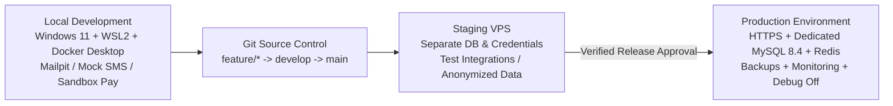
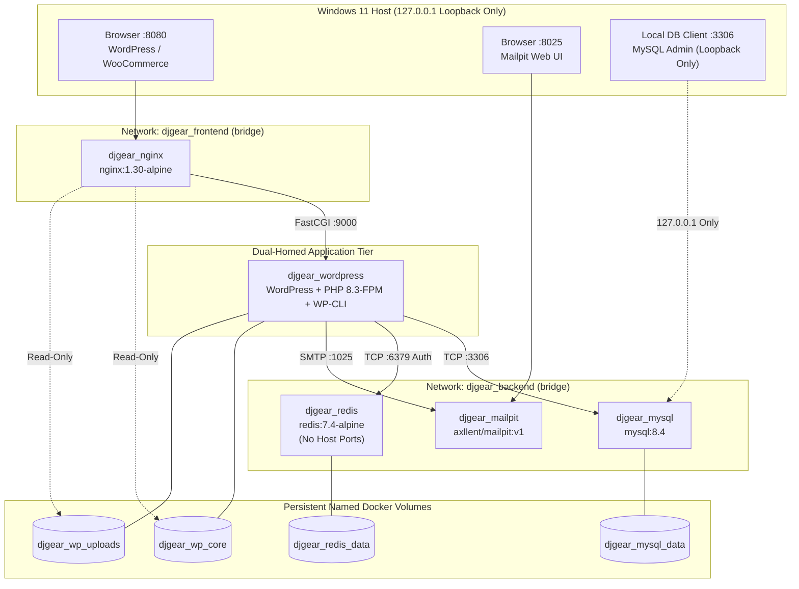

# DJGear.ir — Hybrid Platform Architecture

## 1. Hybrid Development & Deployment Model

DJGear.ir follows a controlled three-tier hybrid delivery model designed for reproducibility, security, and strict version parity:

### Core Invariants
- **Version Parity:** Identical WordPress, WooCommerce, PHP 8.3, MySQL 8.4, Nginx, and Redis versions across Local, Staging, and Production.
- **No Silent Upgrades:** Production image tags and plugin versions are explicitly pinned and promoted through Git after staging verification.
- **Zero Credential Mixing:** Local, staging, and production use completely independent databases, Redis passwords, SMTP endpoints, and API credentials.

---

## 2. Local Docker Architecture

### Security & Isolation Controls
- **Network Segmentation:** `djgear_nginx` is attached exclusively to `djgear_frontend` and cannot directly address `mysql`, `redis`, or `mailpit`.
- **Loopback-Only Bindings:** All exposed ports bind explicitly to `127.0.0.1` (`8080`, `8025`, `3306`). Neither MySQL nor Redis is ever bound to `0.0.0.0`.
- **Redis Private-Only:** Redis publishes zero host ports and enforces password authentication (`--requirepass`).
- **Nginx Hardening:** Blocks `.env`, `.git`, `wp-config.php`, `xmlrpc.php`, and PHP execution inside `/wp-content/uploads/`.
- **PHP Hardening:** `expose_php = Off`, `DISALLOW_FILE_EDIT = true`, dedicated FPM `/ping` healthcheck kept internal to port `9000`.

---

## 3. Database Architecture Decision

- **Standard Engine:** **MySQL 8.4 LTS** across all environments (MariaDB is not used).
- **Character Set:** `utf8mb4` / `utf8mb4_unicode_ci` for full Persian (RTL), English (LTR), and Unicode symbol fidelity.
- **Least-Privilege Access:** WordPress connects exclusively via a dedicated user (`MYSQL_USER`) scoped strictly to `MYSQL_DATABASE.*`. The MySQL `root` account is never configured in WordPress.
- **Persistence:** Database data files live in the named volume `djgear_mysql_data`, preserving schema and rows across container recreation.

---

## 4. Environment Separation Matrix

| Capability | Development (Local) | Staging (VPS) | Production |
| --- | --- | --- | --- |
| Hosting | Windows 11 + WSL2 + Docker Desktop | Dedicated Staging VPS | Controlled Production Server |
| Protocol | `http://localhost:8080` | HTTPS (`staging.djgear.ir`) | HTTPS (`djgear.ir`) |
| Database | Local MySQL 8.4 (`djgear_wp_dev`) | Separate MySQL 8.4 (`djgear_wp_staging`) | Dedicated MySQL 8.4 (`djgear_wp_prod`) |
| Object Cache | Local Redis 7.4 (auth enabled) | Separate Redis 7.4 (auth enabled) | Dedicated Redis 7.4 (auth enabled) |
| Email | Mailpit (`http://localhost:8025`) | Sandbox SMTP | Production Transactional SMTP |
| SMS Provider | Mock Adapter (`DJGEAR_SMS_PROVIDER=mock`) | Mock / Test Sandbox | Production Iranian SMS Adapter |
| Payment Gateway | Sandbox (`DJGEAR_PAYMENT_MODE=sandbox`) | Gateway Sandbox | Live Production Gateway |
| Debugging | `WP_DEBUG=true`, `WP_DEBUG_LOG=true` | `WP_DEBUG_LOG=true`, `DISPLAY=false` | All debugging disabled |
| Customer Data | Synthetic / Seed data only | Synthetic or anonymized only | Live production data + automated backups |

---

## 5. Communication & Payment Adapter Architecture

All external integrations will implement replaceable PHP interfaces registered via `djgear-core`:
- `MailerInterface` — Development defaults to Mailpit (`wp-content/mu-plugins/djgear-dev-mailpit.php` active only when `WP_ENVIRONMENT_TYPE === 'development'`).
- `SmsProviderInterface` — Local development binds `MockSmsProvider` (logs messages locally without network dispatch).
- `PaymentGatewayInterface` — Local development enforces sandbox endpoints only.

---

## 6. Target Modular Application Roadmap (Post-Phase 0)

Every business domain will be built as an independent WordPress plugin alongside the native WordPress Admin, sharing contracts from `djgear-core` and supporting both **Persian (RTL)** and **English (LTR)**:

1. `djgear-core` — Shared service container, provider adapter interfaces, i18n/RTL bootstrap, REST API foundation, audit logging.
2. `djgear-dashboard` — Modern React + TypeScript + Vite administrative workspace operating seamlessly alongside native `wp-admin`.
3. `djgear-sms-center` — Replaceable SMS gateway adapter management, templates, logs, WooCommerce order triggers.
4. `djgear-email-center` — Transactional email templates, provider routing, delivery diagnostics.
5. `djgear-form-builder` — Modular forms, validation, webhook/CRM dispatch.
6. `djgear-crm` — Customer profiles, WooCommerce order intelligence, tagging, support interactions.
7. `djgear-seo-manager` — Structured data (Product/Store schema), Persian/English meta management, sitemaps.
8. `djgear-payment-manager` — Iranian & international payment gateway adapters with strict sandbox/live isolation.
9. `djgear-analytics` — Commerce KPIs, funnel telemetry, dashboard visualizations.
10. `djgear-backup-security` — Hardening policies, activity auditing, backup orchestration hooks.
11. `djgear-theme` — Custom storefront theme engineered for WooCommerce, Persian RTL, and English LTR.
