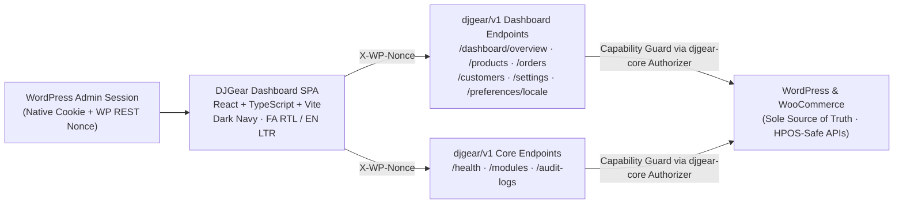

# DJGear Dashboard (`djgear-dashboard`) — Phase 2 Architecture & Implementation Plan

## 1. Architectural Overview

`djgear-dashboard` is an independent WordPress plugin providing a modern, responsive, dark-navy administrative workspace built with **React + TypeScript + Vite**, operating seamlessly alongside native `wp-admin` and integrating exclusively through `djgear-core` contracts.



### Non-Negotiable Invariants
- **Single Source of Truth:** Users, products, inventory, orders, and payments remain exclusively in WordPress & WooCommerce (`wc_get_products()`, `wc_get_orders()`, `WP_User_Query`). Zero duplicated commerce tables.
- **No Second Authentication System:** Uses WordPress session cookies + `wp_rest` nonce (`X-WP-Nonce`) and `djgear-core`'s `Authorizer::restPermissionCallback()`.
- **Native `wp-admin` Preserved:** Mounted cleanly at `wp-admin/admin.php?page=djgear-dashboard` without disabling or breaking native WordPress or WooCommerce screens.
- **Honest Module Status:** Planned Phase 3+ modules (SMS Center, Email Center, Forms, SEO, Analytics, Payments, Backup & Security) display real `djgear-core` metadata and are explicitly labeled **Planned — Not Yet Implemented** rather than faking backend functionality.

---

## 2. Backend Structure (`wp-content/plugins/djgear-dashboard/`)

- `djgear-dashboard.php` — Plugin entrypoint, WooCommerce HPOS (`custom_order_tables`) compatibility declaration, registers `DashboardModule` on `djgear_core_register_modules`.
- `src/DashboardModule.php` — Implements `DJGear\Core\Modules\AbstractModule` (`id: djgear-dashboard`), binds services in `djgear-core`'s `ContainerInterface`, wires admin page & REST controllers.
- `src/Admin/AdminPage.php` — Registers WP Admin page (`djgear_view_dashboard`), reads Vite `assets/dist/.vite/manifest.json`, enqueues compiled assets, injects non-secret boot config (`window.DJGEAR_DASHBOARD_CONFIG`).
- `src/Services/CommerceSummaryService.php` — HPOS-safe WooCommerce product/order/customer data adapter (keeps business logic out of controllers and React).
- `src/Services/SettingsService.php` — Sanitized read/write for central `djgear_core_settings` option with structured audit logging via `AuditLoggerInterface`.
- `src/Rest/*Controller.php` — Capability-gated controllers registered on `djgear/v1` via `djgear_core_register_rest_routes`.

---

## 3. REST API Contracts (`djgear/v1`)

| Endpoint | Method | Required Capabilities | Source of Truth |
| --- | --- | --- | --- |
| `/djgear/v1/health` | `GET` | `djgear_view_dashboard` | `djgear-core` (WP, WC, HPOS, Redis, i18n, provider contracts) |
| `/djgear/v1/modules` | `GET` | `djgear_manage_modules` | `djgear-core` `ModuleRegistry` |
| `/djgear/v1/audit-logs` | `GET` | `djgear_view_logs` | `djgear-core` `djg_djgear_audit_logs` |
| `/djgear/v1/dashboard/overview` | `GET` | `djgear_view_dashboard` | Live WooCommerce/WP counts + core health + recent audit events |
| `/djgear/v1/dashboard/products` | `GET` | `djgear_view_dashboard` + `edit_products` | `wc_get_products()` (paginated, searchable, status-filterable) |
| `/djgear/v1/dashboard/orders` | `GET` | `djgear_view_dashboard` + `edit_shop_orders` | `wc_get_orders()` (HPOS-safe, paginated, status-filterable) |
| `/djgear/v1/dashboard/customers` | `GET` | `djgear_view_dashboard` + `list_users` | `WP_User_Query` + `wc_get_customer_order_count()` |
| `/djgear/v1/dashboard/settings` | `GET`, `POST` | `djgear_manage_core` | `djgear_core_settings` option + audit trail |
| `/djgear/v1/dashboard/preferences/locale` | `POST` | `djgear_view_dashboard` | Current WP user `locale` meta (`fa_IR` / `en_US`) |

---

## 4. Frontend Structure (`wp-content/plugins/djgear-dashboard/frontend/`)

- `src/types/api.ts` — Strict TypeScript interfaces mirroring `djgear/v1` envelopes.
- `src/api/httpClient.ts` & `src/api/djgearApi.ts` — Typed REST client with automatic `X-WP-Nonce` header and explicit `401` / `403` / network error typing.
- `src/i18n/` — Typed Persian (`fa_IR`, RTL) & English (`en_US`, LTR) dictionaries, direction context, live locale persistence, and Persian numeral helper.
- `src/navigation/routes.ts` — Modular grouped sidebar registry with capability annotations.
- `src/styles/theme.css` — Premium Dark Navy design tokens using CSS logical properties for flawless RTL/LTR mirroring and responsive mobile/tablet/desktop breakpoints.
- `src/components/layout/` & `src/components/ui/` — Reusable `AppShell`, `Sidebar`, `Topbar`, `Card`, `Badge`, `DataTable`, and explicit `LoadingState`, `EmptyState`, `ErrorState`, `PermissionDeniedState`, `PlannedModuleBanner`.
- `src/pages/` — `OverviewPage`, `ProductsPage`, `OrdersPage`, `CustomersPage`, `ModuleHubPage` (SMS, Email, Forms, SEO, Analytics, Payments, Backup & Security), `ModulesPage`, `SettingsPage`.

---

## 5. Build & Test Commands

```powershell
# PHP Backend checks (inside djgear_wordpress)
docker compose exec -T -w /var/www/html/wp-content/plugins/djgear-dashboard wordpress sh -c "composer lint && composer analyse && composer test:unit"

# Frontend typecheck, unit tests (Vitest), and Vite production build (Windows host Node.js LTS)
cd wp-content/plugins/djgear-dashboard/frontend
npm.cmd run typecheck
npm.cmd run test
npm.cmd run build

# Live WordPress + WooCommerce integration tests
docker compose exec -T -u www-data wordpress wp eval-file /var/www/html/wp-content/plugins/djgear-dashboard/tests/Integration/wp-dashboard-integration-test.php
```
